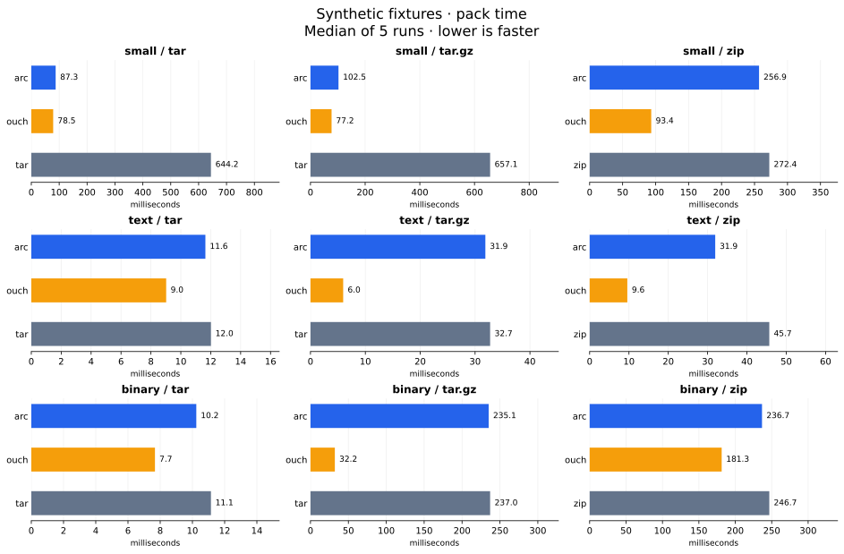
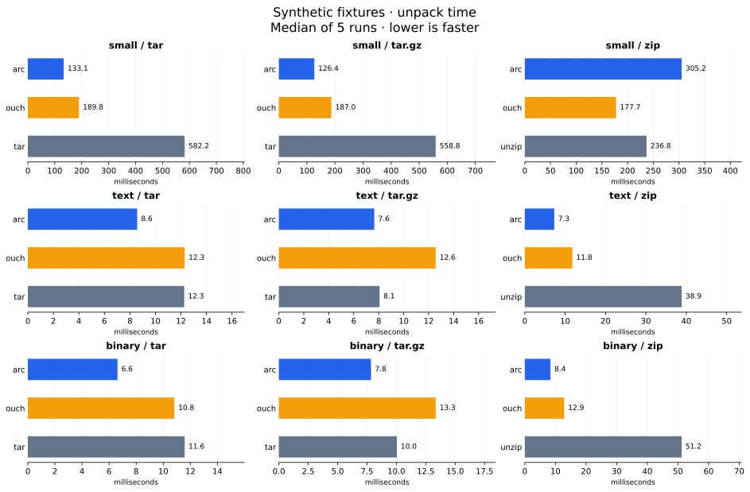
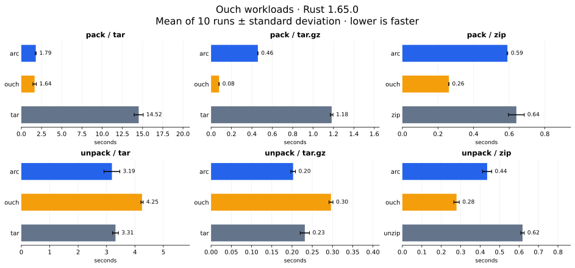
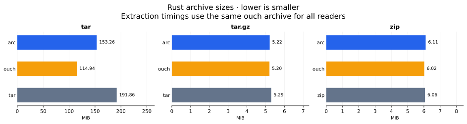

# Archive CLI benchmark

## Recorded run

Measured on 15 October 2026, macOS 26.6.2 ARM64, Python 3.13.15.
Arc 0.2.0 was built with the native CMake Release preset and Homebrew
libarchive 3.8.9 (repository revision `9fa1f180e0f0fbd504045e5e3661a8049d082c95`).
The competitors were Apple's `/usr/bin/tar` (bsdtar 3.5.3, libarchive 3.7.4),
Info-ZIP zip 3.0 / unzip 6.00, and the official
[ouch 0.8.3 macOS ARM64 release](https://github.com/ouch-org/ouch/releases/tag/0.8.3).
The ouch download SHA-256 matched the release API digest:
`969c1bd9105b5033cc9cac0a37c011d23482948d681b43f97c6f79311f3263d0`.

The synthetic fixtures below were measured together in one run. A separate
run on upstream ouch's Rust workloads is reported later in this document.
Earlier two-tool results were exploratory and are superseded by these tables.
These are observations from one machine, not portable performance guarantees.
These snapshots precede the compact extraction-metadata change. See the
[performance experiments](performance-experiment.md) for the follow-up:
ZIP backend isolation, timezone effects, zlib-ng and reduced extraction memory.

## Reproduce

```sh
mise run bench -- --ouch /absolute/path/to/ouch --output build/bench/with-ouch.csv
```

Omit `--ouch` to compare only Arc and system tools. The script does not
install competitors. Override `--seed`, `--size-mib`, `--small-files` or
`--runs` for another workload. All fixtures, archives and extraction directories
are temporary and removed automatically, including on command failure.
Only small reports are retained; generated payloads and tool binaries are not
committed. [Raw samples from this run](benchmark-results.csv) are included.
The generated JSON in `build/bench` additionally contains full file hashes,
executable paths and version output.

Fixture version 1, seed 1729:

- **small:** 2,000 text files of 2,048 bytes each in 20 directories (3.90625 MiB).
- **text:** one 16 MiB file containing repeated UTF-8 records; deliberately very compressible.
- **binary:** one 16 MiB file of seeded pseudorandom bytes; poorly compressible.

Each dataset/format/tool has one warm-up and five measured runs. The starting
tool rotates between runs. Wall-clock timing includes process startup and
command I/O. Source generation, directory cleanup and SHA-256 validation
of extracted file names and bytes are outside the timer. The script verifies
every warm-up and measured extraction; all passed in this run.

## Synthetic results

Blue is Arc, orange is ouch, grey is the system tool. Shorter bars mean less
time. Each panel has its own linear scale starting at zero, so compare tools
within a panel; use the printed values to compare different workloads.





Times are medians in milliseconds; archive size is the median byte count.
`zip / unzip` means zip packs and unzip extracts. Other tools perform both
operations. Each tool extracts the archive it created.

<details>
<summary>Exact synthetic timings and archive sizes</summary>

| Dataset | Format | Pack / unpack tool | Pack ms | Unpack ms | Archive bytes |
|---|---|---|---:|---:|---:|
| small | tar | arc | 87.34 | 133.06 | 7,199,744 |
| small | tar | tar | 644.20 | 582.21 | 9,270,784 |
| small | tar | ouch | 78.47 | 189.76 | 5,131,264 |
| small | tar.gz | arc | 102.48 | 126.36 | 96,708 |
| small | tar.gz | tar | 657.13 | 558.84 | 112,404 |
| small | tar.gz | ouch | 77.17 | 187.03 | 68,407 |
| small | zip | arc | 256.85 | 305.19 | 523,911 |
| small | zip | zip / unzip | 272.39 | 236.82 | 483,831 |
| small | zip | ouch | 93.39 | 177.66 | 468,702 |
| text | tar | arc | 11.64 | 8.57 | 16,779,776 |
| text | tar | tar | 12.01 | 12.25 | 16,783,360 |
| text | tar | ouch | 9.02 | 12.29 | 16,778,752 |
| text | tar.gz | arc | 31.88 | 7.64 | 57,904 |
| text | tar.gz | tar | 32.74 | 8.07 | 58,161 |
| text | tar.gz | ouch | 5.96 | 12.56 | 120,116 |
| text | zip | arc | 31.94 | 7.29 | 57,895 |
| text | zip | zip / unzip | 45.69 | 38.85 | 57,849 |
| text | zip | ouch | 9.59 | 11.79 | 123,319 |
| binary | tar | arc | 10.24 | 6.62 | 16,779,776 |
| binary | tar | tar | 11.15 | 11.58 | 16,783,360 |
| binary | tar | ouch | 7.67 | 10.82 | 16,778,752 |
| binary | tar.gz | arc | 235.13 | 7.84 | 16,782,619 |
| binary | tar.gz | tar | 237.04 | 10.04 | 16,782,871 |
| binary | tar.gz | ouch | 32.16 | 13.35 | 16,783,314 |
| binary | zip | arc | 236.68 | 8.38 | 16,782,526 |
| binary | zip | zip / unzip | 246.68 | 51.20 | 16,779,946 |
| binary | zip | ouch | 181.30 | 12.86 | 16,782,499 |

</details>

## What this run shows

Ouch packs fastest in all nine cases here. The difference is especially large
for TAR.GZ, but this is not evidence that its compression algorithm is better
at an equal compression ratio: the large text TAR.GZ is 120,116 bytes versus
Arc's 57,904 bytes, and its ZIP is 123,319 versus 57,895 bytes. Different
compression defaults/backends can trade space for speed.

Arc extracts faster than ouch in eight of nine cases, including TAR and TAR.GZ
with many small files. Ouch wins the small-file ZIP extraction case
(177.66 ms versus Arc's 305.19 ms); unzip also beats Arc there (236.82 ms).
For the two large-file ZIP cases, Arc extracts substantially faster than unzip.

On small-file TAR/TAR.GZ, Arc is about 6–7 times faster at packing than this
macOS bsdtar, while ouch is faster still. This does not establish the same
relationship with GNU tar on Linux. Even uncompressed TAR sizes differ
substantially, demonstrating different archive metadata/layout overhead.

Pseudorandom data barely compresses. Compression time there mainly buys an
archive approximately the size of its input. Repeated text is an extreme
synthetic case; it does not stand in for a diverse source repository.

## Rust workloads from ouch's benchmark

This second local run uses the upstream workloads and command structure with
Arc added. It is an adaptation, not a run of the unchanged upstream shell
script: Hyperfine 2.0.0 is used, the run count is fixed at ten, and correctness
checks and archive sizes are added. Native macOS bsdtar is used instead of the
GNU tar in upstream's Nix environment. Historical upstream scores are not a
baseline for these numbers.

```sh
mise run bench-ouch -- --ouch /path/to/ouch --hyperfine /path/to/hyperfine
```

The runner downloads Rust 1.65.0 into temporary storage, checks commit
`897e37553bba8b42751c67658967889d11ecd120`, omits `.git` from the benchmark
copy, and copies `rust/compiler` as a separate workload, just as upstream does.
An optional `--source /path/to/rust` reuses that exact checkout without changing
it. Payloads and archives are removed on exit; tool binaries are supplied by
the caller. [Raw timing and peak-memory samples](benchmark-ouch-results.csv)
are retained with this report.

- **rust:** 36,806 files, 90,129,348 content bytes (85.95 MiB). Used for TAR.
- **compiler:** 2,163 files, 23,015,556 content bytes (21.95 MiB). Used for TAR.GZ and ZIP.

Each command has four warm-ups and ten timed samples. Upstream's verbose
commands are preserved and Hyperfine redirects output to the null device.
Arc packs with `--keep-root` to match ouch, tar and zip. Each extraction format
uses **one archive created by ouch for all three readers**. Output directories
are cleaned before every sample; tar's destination is created outside timing.
Command order follows the upstream grouping (ouch, Arc, system tool), rather
than the rotating synthetic harness. After each group, an additional untimed
run validates each participant's extracted file names and SHA-256 content.
All 18 participant/operation checks passed. These checks do not validate
permissions, timestamps or link semantics.

### Visual comparison



Error bars show one standard deviation of observed samples, not confidence
intervals. Each panel starts at zero and uses its own seconds scale.
TAR uses the full Rust tree; TAR.GZ and ZIP use only the compiler subtree.



### Recorded numbers

Times are means ± sample standard deviation in milliseconds. Sizes are from
an additional packing run; extraction timing uses ouch's common input size,
not each tool's packed size. `zip / unzip` names both commands explicitly.

| Format | Pack / unpack tool | Pack ms ± σ | Unpack ms ± σ | Packed archive bytes |
|---|---|---:|---:|---:|
| tar | arc | 1,789.5 ± 55.1 | 3,188.7 ± 279.2 | 160,708,096 |
| tar | ouch | 1,643.3 ± 214.3 | 4,249.0 ± 42.4 | 120,519,168 |
| tar | tar | 14,522.4 ± 560.5 | 3,314.5 ± 103.0 | 201,178,624 |
| tar.gz | arc | 458.7 ± 2.2 | 202.7 ± 5.8 | 5,469,319 |
| tar.gz | ouch | 78.6 ± 2.3 | 296.3 ± 4.9 | 5,455,705 |
| tar.gz | tar | 1,182.2 ± 12.9 | 231.6 ± 11.6 | 5,552,206 |
| zip | arc | 590.0 ± 2.2 | 436.0 ± 23.6 | 6,406,411 |
| zip | ouch | 261.2 ± 1.0 | 278.5 ± 14.2 | 6,315,881 |
| zip | zip / unzip | 640.2 ± 44.5 | 617.9 ± 9.0 | 6,359,222 |

Ouch packs fastest in all three formats on these workloads. Arc is close to
ouch for TAR packing, but slower for TAR.GZ and ZIP. Arc still packs faster
than these system commands in all three cases. For extraction of the shared
TAR and TAR.GZ inputs, Arc's means are lower than ouch's by about 25% and 32%.
Its TAR extraction mean is only about 4% below tar's, within the observed
variation; that small gap is not a strong ranking. For ZIP, ouch extracts
faster than Arc (279 ms versus 436 ms), and Arc is faster than unzip (618 ms).

On this real-source workload, ouch's compressed archives are also slightly
smaller: TAR.GZ differs from Arc by about 0.25%, ZIP by about 1.4%. The large
speed gap here comes without the synthetic repeated-text size penalty.
Uncompressed TAR has much larger layout/metadata differences: Arc's output is
153.26 MiB, ouch's 114.94 MiB and tar's 191.86 MiB, despite matching extracted
file contents. The benchmark does not attribute those extra bytes to a specific
metadata feature. On TAR extraction, Hyperfine reports average peak RSS
of about 85.6 MiB for Arc, 8.6 MiB for ouch and 4.1 MiB for tar. Arc's faster
mean against ouch in this scenario comes with a higher measured memory peak.
The full timing and memory samples are in the CSV; the scripts do not flush
caches or sync writes to disk.

Hyperfine flagged the first TAR.GZ extraction sample for tar as slower than
the others (260 ms). It is retained in the mean and error bar. Other local
loads and cache state can affect these results; four warm-ups do not eliminate
all variation.

## Limits of the synthetic benchmark

These are warm-cache measurements, without cache flushing or explicit disk
sync. They measure CLI completion, not durable storage throughput. The synthetic
benchmark measures no CPU or
peak-memory usage is measured. With five samples and millisecond operations,
small differences can be noise; raw samples allow inspection of spread.

Compression levels, thread counts and metadata policies use tool defaults.
Arc, ouch and system tools have different extraction contracts and checks.
Tar receives `-C SOURCE .`, zip receives `-q -r ARCHIVE .`, and ouch receives
explicit sorted children of SOURCE to omit its otherwise retained root directory.
Arc's single-directory packing already omits the root. Ouch uses `--quiet`;
all command output is captured. Input directory creation for tar/unzip is
outside timing; Arc/ouch create their output directory inside the command.

Extracting each tool's own output answers the practical pack/unpack workflow
question, but mixes reader speed with writer layout and compression choices.
It does not isolate decompressor speed. Checks cover file names and contents,
not permission/timestamp restoration, links, adversarial archives or overwrite
safety. Benchmarks cannot establish general feature or safety superiority.

## Comparison with ouch's benchmark

Reviewed upstream benchmark sources at revision `6df14b05ea6d1e600f1f3ff16bccd4a756c20c94`:
[setup](https://github.com/ouch-org/ouch/blob/6df14b05ea6d1e600f1f3ff16bccd4a756c20c94/benchmarks/setup-benchmarks.sh),
[runner](https://github.com/ouch-org/ouch/blob/6df14b05ea6d1e600f1f3ff16bccd4a756c20c94/benchmarks/run-benchmarks.sh),
[published results](https://github.com/ouch-org/ouch/blob/6df14b05ea6d1e600f1f3ff16bccd4a756c20c94/benchmarks/results.md).

Their setup pins Rust 1.65.0 source: about 229 MB for TAR and its 27 MB
compiler subtree for TAR.GZ/ZIP. Their runner uses Hyperfine, four warm-ups,
fresh outputs and one ouch-created input per format for extraction. The
published report includes mean, deviation, minimum, maximum and relative time;
the README identifies the measured ouch as 0.4.0. Those historical numbers
cannot be compared directly with our current local 0.8.3 run.

| Capability | Arc synthetic benchmark | Upstream ouch benchmark |
|---|---|---|
| Input | Three deterministic synthetic workloads, disposable | Pinned real Rust source, downloaded and retained |
| Formats | TAR, TAR.GZ, ZIP on every workload | Same formats, different input sizes by format |
| Participants | Arc, tar, zip/unzip, optional ouch | Ouch versus tar or zip/unzip |
| Warm-up/statistics | One warm-up, five samples, median; raw CSV | Four warm-ups; Hyperfine statistics and relative times |
| Extraction input | Each tool's own archive | Same ouch-created archive for all readers |
| Output validation | SHA-256 file-content and name checks | No content validation in the runner |
| Archive size | Reported alongside speed | Not reported in the result table |

Our synthetic harness is better suited to a lightweight, reproducible smoke comparison
across compressibility and file-count extremes, with correctness and size
visible. Their setup is better for a realistic source-tree workload, richer
timing statistics and comparing readers on an identical archive. Neither
covers CPU/memory, a broad real-world corpus or functional archive features.

The separate Rust runner above now adds that pinned real-source workload,
four warm-ups, Hyperfine statistics, peak-memory samples and shared-archive
extraction, while keeping payloads temporary and validating file contents.
The two modes answer complementary questions: synthetic extremes and a real
source tree. Further coverage would need a more diverse real corpus, repeated
runs on other platforms and explicit compression-level/thread comparisons.
