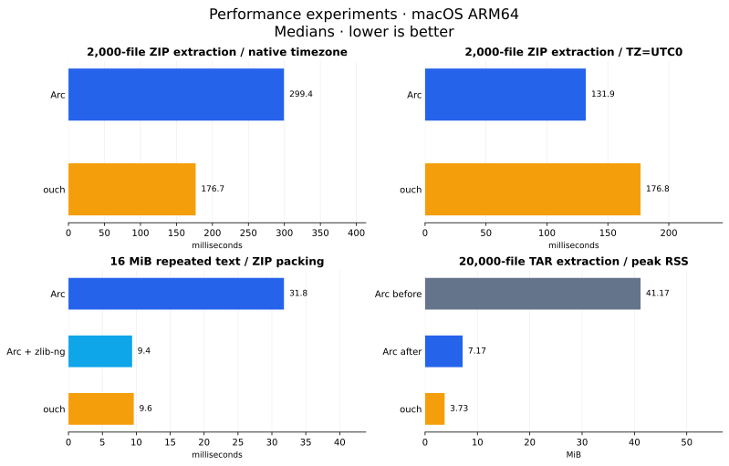

# Archive benchmarks

Local measurements on 15 October 2026, macOS 26.6.2 ARM64. Arc 0.2.0,
native CMake Release with Homebrew libarchive 3.8.9 and system zlib 1.2.12;
[ouch 0.8.3](https://github.com/ouch-org/ouch), macOS bsdtar 3.5.3
(libarchive 3.7.4), Info-ZIP zip 3.0 / unzip 6.00. Python 3.13.15 and
Hyperfine 2.0.0 drive the runs. These are warm-cache CLI measurements from
one machine, including startup and I/O but no explicit disk sync.

## Findings and recorded versions

Arc extracted faster than ouch in eight of nine synthetic cases and on the
shared Rust TAR/TAR.GZ inputs. Ouch packed fastest throughout the baseline
comparisons and won small-file ZIP extraction. Compression ratios and
metadata policies differ; speed alone does not establish feature superiority.

Later changes reduced extraction memory by 83% and reduced integer-mtime
small-file TAR size by 29%, with a 9% packing improvement in that run.
Rust TAR packing did not improve measurably. ZIP experiments identified a
large timezone-conversion cost and a compression speed/size trade-off.

| Snapshot | Arc baseline → measured change | Status |
|---|---|---|
| Synthetic and upstream Rust comparison | `9fa1f18` | Before both optimizations |
| ZIP and extraction memory | `b6221fb` → compact extraction metadata in `28545fb` | Memory change implemented; UTC and zlib-ng are experiments |
| TAR packing | `28545fb` → timestamp cleanup and query reuse in `9022930` | Implemented |

The original tables describe their recorded builds, not the current release.
Do not combine timings from different runs into one ranking.

## Synthetic comparison

Fixture version 1, seed 1729: 2,000 × 2,048-byte files in 20 groups, one
16 MiB repeated UTF-8 text file, and one 16 MiB seeded pseudorandom file.
One warm-up and five samples per case, rotating tool order; medians below.
Each tool extracts its own archive. All warm-up and measured extractions
passed filename/SHA-256 checks outside the timer.

Blue: Arc; orange: ouch; grey: system tool. Each panel has an independent
zero-based linear scale. `zip / unzip` names packing and extraction tools.

Exact synthetic timings and archive sizes

| Dataset | Format | Pack / unpack tool | Pack ms | Unpack ms | Archive bytes |
|---|---|---|---:|---:|---:|
| small | tar | arc | 87.34 | 133.06 | 7,199,744 |
| small | tar | tar | 644.20 | 582.21 | 9,270,784 |
| small | tar | ouch | 78.47 | 189.76 | 5,131,264 |
| small | tar.gz | arc | 102.48 | 126.36 | 96,708 |
| small | tar.gz | tar | 657.13 | 558.84 | 112,404 |
| small | tar.gz | ouch | 77.17 | 187.03 | 68,407 |
| small | zip | arc | 256.85 | 305.19 | 523,911 |
| small | zip | zip / unzip | 272.39 | 236.82 | 483,831 |
| small | zip | ouch | 93.39 | 177.66 | 468,702 |
| text | tar | arc | 11.64 | 8.57 | 16,779,776 |
| text | tar | tar | 12.01 | 12.25 | 16,783,360 |
| text | tar | ouch | 9.02 | 12.29 | 16,778,752 |
| text | tar.gz | arc | 31.88 | 7.64 | 57,904 |
| text | tar.gz | tar | 32.74 | 8.07 | 58,161 |
| text | tar.gz | ouch | 5.96 | 12.56 | 120,116 |
| text | zip | arc | 31.94 | 7.29 | 57,895 |
| text | zip | zip / unzip | 45.69 | 38.85 | 57,849 |
| text | zip | ouch | 9.59 | 11.79 | 123,319 |
| binary | tar | arc | 10.24 | 6.62 | 16,779,776 |
| binary | tar | tar | 11.15 | 11.58 | 16,783,360 |
| binary | tar | ouch | 7.67 | 10.82 | 16,778,752 |
| binary | tar.gz | arc | 235.13 | 7.84 | 16,782,619 |
| binary | tar.gz | tar | 237.04 | 10.04 | 16,782,871 |
| binary | tar.gz | ouch | 32.16 | 13.35 | 16,783,314 |
| binary | zip | arc | 236.68 | 8.38 | 16,782,526 |
| binary | zip | zip / unzip | 246.68 | 51.20 | 16,779,946 |
| binary | zip | ouch | 181.30 | 12.86 | 16,782,499 |

Ouch's repeated-text TAR.GZ was 120,116 bytes versus Arc's 57,904 bytes:
the compression speed gap includes a space trade-off. Pseudorandom data
barely compresses. Arc's small-file TAR packing was 6–7 times faster than
this macOS bsdtar; this does not establish the same result for GNU tar.
Raw samples: [synthetic CSV](benchmark-results.csv).

## Rust workloads from ouch

Our adaptation uses pinned Rust 1.65.0 at
`897e37553bba8b42751c67658967889d11ecd120`, omits `.git` and retains the
root name with `--keep-root`. Full Rust: 36,806 files / 90,129,348 content
bytes for TAR. Compiler subtree: 2,163 files / 23,015,556 bytes for TAR.GZ
and ZIP. These compressed workloads differ from the later full-tree TAR test.

Four warm-ups and ten samples per command; Hyperfine means ± sample standard
deviation, fixed upstream tool grouping. All readers use one ouch-created
input per format. Outputs are cleaned between samples; an additional untimed
run after each group checks filenames and SHA-256 bytes (all 18 passed).
Those checks do not validate timestamps, permissions or links.

Error bars are sample deviations, not confidence intervals. Independent
zero-based scales; packed sizes differ from the shared extraction input.

Exact Rust timings and archive sizes

| Format | Pack / unpack tool |Pack ms | Unpack ms | Archive bytes |
|---|---|---|---:|---:|---:|
| small | tar | arc | 87.34 | 133.06 | 7,199,744 |
| small | tar | tar | 644.20 | 582.21 | 9,270,784 |
| small | tar | ouch | 78.47 | 189.76 | 5,131,264 |
| small | tar.gz | arc | 102.48 | 126.36 | 96,708 |
| small | tar.gz | tar | 657.13 | 558.84 | 112,404 |
| small | tar.gz | ouch | 77.17 | 187.03 | 68,407 |
| small | zip | arc | 256.85 | 305.19 | 523,911 |
| small | zip | zip / unzip | 272.39 | 236.82 | 483,831 |
| small | zip | ouch | 93.39 | 177.66 | 468,702 |
| text | tar | arc | 11.64 | 8.57 | 16,779,776 |
| text | tar | tar | 12.01 | 12.25 | 16,783,360 |
| text | tar | ouch | 9.02 | 12.29 | 16,778,752 |
| text | tar.gz | arc | 31.88 | 7.64 | 57,904 |
| text | tar.gz | tar | 32.74 | 8.07 | 58,161 |
| text | tar.gz | ouch | 5.96 | 12.56 | 120,116 |
| text | zip | arc | 31.94 | 7.29 | 57,895 |
| text | zip | zip / unzip | 45.69 | 38.85 | 57,849 |
| text | zip | ouch | 9.59 | 11.79 | 123,319 |
| binary | tar | arc | 10.24 | 6.62 | 16,779,776 |
| binary | tar | tar | 11.15 | 11.58 | 16,783,360 |
| binary | tar | ouch | 7.67 | 10.82 | 16,778,752 |
| binary | tar.gz | arc | 235.13 | 7.84 | 16,782,619 |
| binary | tar.gz | tar | 237.04 | 10.04 | 16,782,871 |
| binary | tar.gz | ouch | 32.16 | 13.35 | 16,783,314 |
| binary | zip | arc | 236.68 | 8.38 | 16,782,526 |
| binary | zip | zip / unzip | 246.68 | 51.20 | 16,779,946 |
| binary | zip | ouch | 181.30 | 12.86 | 16,782,499 |

## What this run shows

Arc's extraction means were about 25% below ouch for TAR and 32% for TAR.GZ.
Its 4% TAR gap against bsdtar is within observed variation. Ouch won ZIP
extraction and all packing cases. Arc's compressed archives were slightly
larger (TAR.GZ 0.25%, ZIP 1.4%). Original TAR peak RSS averaged 85.6 MiB
for Arc, 8.6 MiB for ouch and 4.1 MiB for tar; the later 20,000-file memory
experiment below uses a different corpus and statistic. Hyperfine flagged
tar's first TAR.GZ extraction sample (260 ms); it remains in the results.
Raw samples: [Rust timing and memory CSV](benchmark-ouch-results.csv).

## Optimization experiments

| Change or experiment | Observed result | Interpretation |
|---|---|---|
| Compact extraction metadata | 20,000-file TAR peak RSS: 41.17 → 7.17 MiB | Implemented; directory and hard-link metadata preserved |
| TAR timestamp cleanup + query reuse | Integer-mtime TAR: 76.02 → 69.01 ms; 7,201,280 → 5,131,776 bytes | Implemented; unsupported time fields omitted, full PAX retained |
| Explicit `TZ=UTC0` for every participant | Small ZIP extraction: Arc 131.92 ms, ouch 176.82 ms | Environment experiment; native Arc 299.39 ms vs ouch 176.73 ms |
| Isolated zlib-ng 2.3.3 | Repeated-text ZIP: 31.78 → 9.39 ms; 57,895 → 107,103 bytes | Prototype; faster compression produces a larger archive |

### ZIP and extraction memory

ZIP uses the same generated fixtures, one warm-up and seven samples,
rotating tool order. All warm-up and measured outputs passed name/content
checks. Both timezone settings extract the same ouch ZIP; these checks do
not establish equivalent restored timestamps. Memory uses a separate
20,000-file TAR, one warm-up and three Hyperfine peak-RSS samples, medians;
final extracted content was checked. Ouch peak RSS was 3.73 MiB.

A temporary probe attributed about 170 ms of a 300 ms small ZIP extraction
to libarchive header processing; entry cloning took about 1 ms. Libarchive's
[ZIP reader](https://github.com/libarchive/libarchive/blob/v3.8.9/libarchive/archive_read_support_format_zip.c)
uses `mktime` for DOS timestamp conversion. Explicit UTC reduced diagnostic
header time from about 173 ms to 5 ms. Arc does not change the caller's `TZ`:
ZIP DOS timestamps have no timezone, so changing it can alter restored times.

The backend-only probe uses libarchive extraction but lacks Arc's complete
ownership, conflict, error and metadata contracts. It is diagnostic only.
The isolated compression build was checked to load zlib-ng 2.3.3 in zlib
compatibility mode (Clang 22.1.8, CMake Release). No production dependency
or compression default changed. Raising its ZIP level to 9 recovered the
ordinary archive size: 19.44 ms / 57,564 bytes versus ordinary Arc
31.71 ms / 57,895 and ouch 10.01 ms / 123,319. The default fast-build gap
against ouch (9.39 vs 9.63 ms) is not a robust ranking; random binary still
packed slower (203.14 vs 183.11 ms).

Native and UTC timings

| Environment | Dataset | Operation | Arc | Arc + zlib-ng | ouch | Backend-only |
|---|---|---|---:|---:|---:|---:|
| default | small | pack | 253.28 | 250.76 | 91.58 | 234.76 |
| default | small | unpack | 299.39 | 302.80 | 176.73 | 311.58 |
| default | text | pack | 31.78 | 9.39 | 9.63 | 31.78 |
| default | text | unpack | 10.03 | 9.51 | 13.80 | 10.37 |
| default | binary | pack | 232.46 | 203.14 | 183.11 | 231.99 |
| default | binary | unpack | 8.06 | 9.42 | 12.76 | 7.46 |
| utc | small | pack | 95.85 | 92.01 | 92.91 | 77.35 |
| utc | small | unpack | 131.92 | 132.01 | 176.82 | 147.50 |
| utc | text | pack | 31.73 | 9.25 | 9.67 | 31.60 |
| utc | text | unpack | 6.86 | 8.11 | 12.01 | 6.66 |
| utc | binary | pack | 233.11 | 202.70 | 181.39 | 232.54 |
| utc | binary | unpack | 7.77 | 8.96 | 13.06 | 7.18 |

Raw data: [ZIP samples](benchmark-zip-results.csv),
[ZIP environment metadata](benchmark-zip-environment.json),
[compression levels](benchmark-compression-levels.csv),
[peak memory](benchmark-memory-results.csv).

### TAR packing

Timestamp cleanup omits access/change/creation times, outside Arc's supported
restoration policy. For ordinary integer-mtime entries it removes unnecessary
PAX records. Fractional mtime and long-path/link metadata still use full PAX.
Traversal now passes its fresh filesystem information to the writer instead
of making a second query; output exclusion and link checks remain intact.

Integer-mtime small TAR improved by 9.2% in time and 28.7% in size; TAR.GZ
by 11.0% and 50.7%. Rust TAR showed no improvement (1,751.90 → 1,771.98 ms),
with unchanged size. Rust TAR.GZ shrank 2.7%; its 1.5% timing gap is too small
for a robust conclusion. Ouch remained faster in all cases and omitted
fractional mtime; smaller fractional TAR output preserves less time precision.

One warm-up and five samples per case, rotating order, native timezone.
Integer/fractional fixtures have the same 2,000-file payload and 2,021 entries;
fractional mtime is 1700000000.123456700. Integer PAX entries fell from 2,021
to zero; fractional entries still require PAX. Fresh full Rust checkout:
39,522 entries, all fractional mtime, root `arc-tar-rust-1.65.0`. Checkout
times and root names differ from the original Rust comparison.

TAR medians (ms) and archive sizes (bytes)

| Dataset | Format |Before ms | Metadata ms | After ms | ouch ms | Before bytes | After bytes | ouch bytes |
|---|---|---:|---:|---:|---:|---:|---:|---:|
| integer | tar | 76.02 | 72.32 | 69.01 | 61.06 | 7,201,280 | 5,131,776 | 5,131,776 |
| integer | tar.gz | 90.08 | 86.29 | 80.22 | 58.13 | 96,403 | 47,525 | 68,578 |
| fractional | tar | 72.35 | 72.98 | 68.37 | 59.41 | 7,201,280 | 7,201,280 | 5,131,776 |
| fractional | tar.gz | 89.25 | 86.12 | 82.27 | 58.50 | 108,391 | 81,424 | 68,433 |
| source | tar | 1751.90 | 1828.12 | 1771.98 | 1386.62 | 160,708,096 | 160,708,096 | 121,851,392 |
| source | tar.gz | 3190.29 | 3264.09 | 3144.00 | 1367.77 | 22,995,661 | 22,374,582 | 21,391,328 |

`Metadata` includes only timestamp cleanup; `After` also reuses the filesystem
query. Intermediate archive sizes equal `After`. All 24 warm-up archives
passed Arc extraction name/SHA-256 checks; all Arc warm-ups also passed exact
source nanosecond mtime checks. Ouch time precision was not required to match.
Measured packing outputs were not individually unpacked. Extraction here
is validation, not another timing comparison. Raw data:
[TAR samples](benchmark-tar-results.csv), [run metadata/PAX counts](benchmark-tar-results.json).

## Methodology and reproduction

Generated payloads and downloaded Rust copies are temporary and removed on
exit; only reports persist. See [build tooling](build.md#development-tools)
for commands, optional binaries, probes and chart regeneration. Seed/version
reproduce content, not timing or identical archives across platforms.

| Harness | Samples/statistic | Extraction input | Best use |
|---|---|---|---|
| `bench.py` | 1 warm-up, 5 runs, median | Each writer's output | Compressibility and file-count extremes |
| `bench-ouch.py` | 4 warm-ups, 10 runs, Hyperfine mean/deviation | Shared ouch archive | Pinned real source and reader comparison |
| `bench-zip.py` | 1 warm-up, 7 runs, median | Shared ouch ZIP across environments | Timezone/backend isolation |
| `bench-tar.py` | 1 warm-up, 5 runs, median | Warm-up validation only | Timestamp overhead and writer changes |

Upstream ouch benchmark reviewed at
`6df14b05ea6d1e600f1f3ff16bccd4a756c20c94`:
[setup](https://github.com/ouch-org/ouch/blob/6df14b05ea6d1e600f1f3ff16bccd4a756c20c94/benchmarks/setup-benchmarks.sh),
[runner](https://github.com/ouch-org/ouch/blob/6df14b05ea6d1e600f1f3ff16bccd4a756c20c94/benchmarks/run-benchmarks.sh),
[results](https://github.com/ouch-org/ouch/blob/6df14b05ea6d1e600f1f3ff16bccd4a756c20c94/benchmarks/results.md).
Its pinned real-source/shared-input method is better for realistic reader
comparisons; our synthetic harness adds deterministic extremes, archive
sizes and content validation. The adapted Rust runner combines those benefits
with peak-memory samples and temporary payloads. Historical upstream ouch
0.4.0 scores and GNU tar/Nix results are not baselines for our macOS run.

Tool defaults differ in compression, metadata and extraction contracts.
The synthetic harness measures no CPU or peak memory. Content checks do not
prove safety or feature parity. No harness flushes caches; small timing gaps
may be noise. Broader corpora and other platforms are needed for general claims.

The extraction-metadata change passed four C tests and 306 CLI tests;
ASan/UBSan passed four C and 82 selected CLI tests. TAR changes passed four
C and 308 CLI tests; ASan/UBSan passed four C and 108 selected CLI tests.
Full suites had 26 Windows-only skips, sanitizer selections 12; formatting
passed. Windows behavior was not executed on this host.
