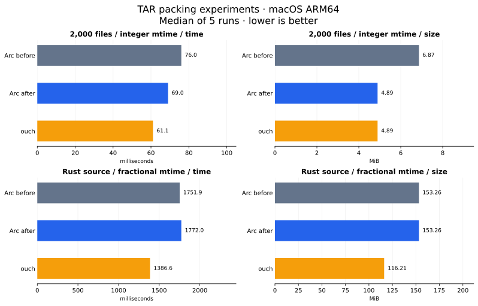

# TAR packing experiments

Measured on 15 October 2026, macOS 26.6.2 ARM64, native Release,
libarchive 3.8.9 and system zlib 1.2.12. Baseline: Arc at `28545fb`.
Ouch: official [0.8.3 ARM64 release](https://github.com/ouch-org/ouch).

## Changes and outcome

Arc now omits access, change and creation times from writer metadata. These
are outside its supported restoration policy. Ordinary TAR records with
integer mtime no longer need an extra PAX record just for these fields.
Full PAX remains enabled: fractional mtime, long paths and link metadata
retain their existing behavior.

Packing also reuses the filesystem information already fetched by traversal,
removing the second `arc_fs_info` call per packed entry. Output-file exclusion,
link identity and capability checks still use the same fresh information.
The existing stable-input concurrency contract is unchanged.

On 2,000 small files with integer mtime, TAR packing fell from 76.02 to
69.01 ms (9.2%) and archive size fell by 28.7%. TAR.GZ fell from 90.08 to
80.22 ms (11.0%) and size fell by 50.7%. These are local five-sample medians,
not a guarantee across machines or workloads.

Rust-source TAR showed no speed improvement: 1,751.90 ms before versus
1,771.98 ms after. Its size stayed unchanged because every entry still
needs PAX for fractional mtime. TAR.GZ size fell by 2.7%, while its 1.5%
timing difference is too small to treat as a robust gain. Ouch remains
faster on all these packing cases. It omits fractional mtime, so its smaller
fractional/source TAR files do not preserve the same timestamp information.



Each panel has an independent zero-based scale. The source corpus uses a
fresh checkout, whose timestamps differ from the earlier benchmark.

## Measurements

One warm-up and five samples per case, rotating tool order; native timezone.
`metadata` includes only timestamp cleanup; `after` also removes the repeated
filesystem query. Times are milliseconds; sizes are bytes. The intermediate
build has the same archive sizes as `after`.

| Dataset | Format | Before ms | Metadata ms | After ms | ouch ms | Before bytes | After bytes | ouch bytes |
|---|---|---:|---:|---:|---:|---:|---:|---:|
| integer | tar | 76.02 | 72.32 | 69.01 | 61.06 | 7,201,280 | 5,131,776 | 5,131,776 |
| integer | tar.gz | 90.08 | 86.29 | 80.22 | 58.13 | 96,403 | 47,525 | 68,578 |
| fractional | tar | 72.35 | 72.98 | 68.37 | 59.41 | 7,201,280 | 7,201,280 | 5,131,776 |
| fractional | tar.gz | 89.25 | 86.12 | 82.27 | 58.50 | 108,391 | 81,424 | 68,433 |
| source | tar | 1751.90 | 1828.12 | 1771.98 | 1386.62 | 160,708,096 | 160,708,096 | 121,851,392 |
| source | tar.gz | 3190.29 | 3264.09 | 3144.00 | 1367.77 | 22,995,661 | 22,374,582 | 21,391,328 |

[Raw samples](benchmark-tar-results.csv) contain 120 timed packing runs.
[Run metadata](benchmark-tar-results.json) records parameters, versions and
PAX counts for all 24 warm-up archives. Each warm-up was unpacked with Arc
and checked for filenames and SHA-256 content outside the packing timer.
All Arc warm-up archives also passed exact nanosecond mtime checks against
source filesystem metadata. Ouch timestamps were not required to match.
Unpacking here is validation, not a new extraction timing comparison.

The integer fixture has 2,000 seeded 2,048-byte files in 20 groups, plus the
root record: 2,021 entries. Baseline emitted PAX for all 2,021; updated Arc
emitted none. The fractional fixture has the same bytes with mtime
1700000000.123456700; updated Arc still emits PAX for every entry.

The source fixture is Rust 1.65.0 at
`897e37553bba8b42751c67658967889d11ecd120`, excluding `.git`, copied with
symlinks and timestamps preserved. It has 39,522 archive entries, all with
fractional mtime. The archived root name is `arc-tar-rust-1.65.0`; different
root names and checkout times make its byte sizes unsuitable for direct
comparison with the older Rust report. Repeated source reads warm caches.

## Reproduce

The script generates both small fixtures in a temporary directory, copies
an optional source corpus and deletes payloads and archives when finished.
Only the CSV and small JSON report persist. No new production dependency.

```sh
mise run release
mise exec -- python scripts/bench-tar.py --ouch /path/to/ouch --runs 5
# Optional: --arc-before /path/to/baseline/arc
# Optional: --arc-metadata /path/to/metadata-only/arc
# Optional: --source /path/to/rust-1.65.0
```

Source bytes and generated fixtures are reproducible; fresh-checkout ctime
and mtime, compressed byte sizes and timings vary between runs. A recreated
baseline needs a Release build of `28545fb` with the same backend. The
metadata-only checkpoint has the timestamp cleanup in
`libarchive_adapter.c` and the baseline writer.

Regenerate the chart using the plotting environment in [build.md](build.md):

```sh
python scripts/plot-bench.py --tar-experiment docs/benchmark-tar-results.csv
```

## Verification

All four native C tests and the full CLI suite passed: 308 passed, 26
Windows-only skips. ASan/UBSan passed all four C tests and 108 selected
packing/unpacking CLI tests, with 12 Windows-only skips. C formatting
validation passed. Added tests inspect absent unsupported time fields,
a single ordinary TAR header for integer mtime and exact restored mtime.
Existing fractional hard-link, unsafe-path and output-exclusion tests pass.
Windows execution remains unverified on this host.
